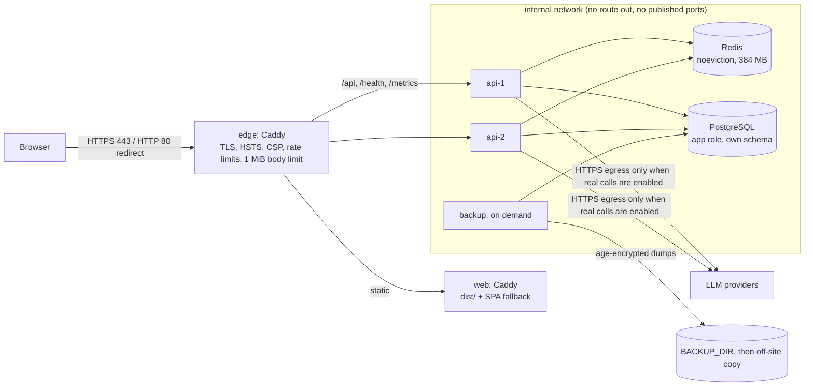

# Deployment runbook

Production deployment of the Distributed Multi-Model Router on **one Linux VM with Docker Compose**
(Step 11.1 recommendation). Everything here was verified locally with an isolated Compose project
(see [Local verification](#local-verification)); nothing has been deployed to a cloud yet.

> Never commit or paste real secrets. Real configuration lives **outside the repository**, mode `600`.
> Mock mode (`LLM_MOCK_MODE=true`) stays on until you deliberately enable real providers
> ([Enabling real providers](#enabling-real-providers)).

## Contents
1. [Architecture](#architecture)
2. [Files](#files)
3. [Server prerequisites](#server-prerequisites)
4. [Configuration and secrets](#configuration-and-secrets)
5. [Build the images](#build-the-images)
6. [Fresh database initialisation](#fresh-database-initialisation)
7. [Deployment sequence](#deployment-sequence)
8. [Health checks](#health-checks)
9. [Smoke tests](#smoke-tests)
10. [Backup and restore](#backup-and-restore)
11. [Rollback](#rollback)
12. [Secret rotation](#secret-rotation)
13. [Monitoring](#monitoring)
14. [Enabling real providers](#enabling-real-providers)
15. [Common errors](#common-errors)
16. [Local verification](#local-verification)

## Architecture



| Service | Image | Networks | Runs as | Notes |
|---|---|---|---|---|
| `edge` | `llm-router-edge` (Caddy 2.11.9 + caddy-ratelimit) | edge (fixed IP) | uid 10003 | Only service with published ports (80, 443 TCP+UDP). Certificates in volume `caddy_data`. |
| `web` | `llm-router-web` (Caddy 2.11.9, static) | edge | uid 10002 | Built `dist/` only; hashed assets cached 1 year, everything else `no-cache`. |
| `api-1`, `api-2` | `llm-router-api` (Python 3.13.18) | edge, internal | uid 10001 | One uvicorn process each. `api-2` starts after `api-1` is healthy (migrations run once, under an advisory lock). |
| `redis` | `redis:7.4.12-alpine` | internal | uid 999 (`redis`) | `requirepass` (fed on stdin, never in process args), AOF, `maxmemory 384mb`, `noeviction`. |
| `postgres` | `postgres:16.15-alpine` | internal | uid 70 (`postgres`) | scram-sha-256 (host and local); app connects as a non-superuser that owns one schema. |
| `backup` (profile `tools`) | `llm-router-backup` (pg 16 client + age) | internal | uid 70 | Run on demand / from cron. |

All services: non-root from the first process (no entrypoint starts as root), read-only root filesystem, `tmpfs`
for scratch paths, `cap_drop: ALL` with **no** capabilities added back, `no-new-privileges`, CPU/memory/PID limits,
json-file logs rotated (5 × 10 MB). Redis and PostgreSQL run as their image users directly, so a fresh named volume
inherits the image's directory ownership; volumes created by an older root-started setup must be owned by
999:1000 (Redis) / 70:70 (PostgreSQL). Every service shuts down cleanly on `docker compose stop` (SIGTERM reaches PID 1).

## Files

| File | Purpose |
|---|---|
| `docker-compose.prod.yml` | The production stack (self-contained; **not** combined with `docker-compose.yml`). |
| `backend/Dockerfile`, `frontend/Dockerfile`, `infrastructure/caddy/Dockerfile`, `infrastructure/backup/Dockerfile` | Images (build context = repository root). |
| `.dockerignore` | Allowlist build context: no `.env`, tests, benchmarks, caches or `node_modules` reach any image. |
| `infrastructure/Caddyfile` | Edge proxy. `infrastructure/web.Caddyfile`: static server. |
| `infrastructure/postgres/init/10-app-role.sh` | Creates the application role and schema on a **fresh** volume. |
| `infrastructure/backup/backup.sh`, `restore-verify.sh` | Encrypted backups and restore drills. |
| `infrastructure/deploy.env.example` | Template for `deploy.env` (infrastructure + data-service secrets). |
| `.env.production.example` | Template for `app.env` (API tokens, chat keys, budgets, providers). |
| `requirements.txt` / `requirements-dev.txt` | Runtime dependencies (image) / development and tests. |

## Server prerequisites
- Ubuntu 24.04 LTS (or similar), 2 vCPU / 4 GB RAM minimum, 40 GB disk; Docker Engine ≥ 25 with the Compose plugin.
- DNS `A`/`AAAA` record for your domain pointing at the server **before** first start (ACME needs it).
- Firewall: allow **80/tcp, 443/tcp, 443/udp** from anywhere; SSH only from your IP. Nothing else.
- A checkout of this repository at the deployed commit (the Compose file mounts `infrastructure/postgres/init`).
- `age` on your workstation (to create the backup key pair and run restore drills).

## Configuration and secrets

Create both files outside the repository:

```bash
sudo install -d -m 700 /etc/llm-router
sudo cp infrastructure/deploy.env.example /etc/llm-router/deploy.env
sudo cp .env.production.example        /etc/llm-router/app.env
sudo chmod 600 /etc/llm-router/*.env
```

Generate **every** secret separately (never reuse one value for two settings):

```bash
python3 -c "import secrets; print(secrets.token_urlsafe(48))"
```

| File | Setting | Requirement |
|---|---|---|
| deploy.env | `LLMR_DOMAIN` | Your public hostname. |
| deploy.env | `LLMR_APP_ENV_FILE` | Absolute path of `app.env`. |
| deploy.env | `POSTGRES_ADMIN_PASSWORD` | ≥ 16 chars, random. Operations only. |
| deploy.env | `POSTGRES_APP_USER` / `POSTGRES_APP_PASSWORD` | App role (≠ admin); password ≥ 16 chars, random. |
| deploy.env | `REDIS_PASSWORD` | ≥ 16 chars, random. |
| deploy.env | `BACKUP_AGE_RECIPIENT`, `BACKUP_DIR` | age **public** key; host directory for encrypted dumps. |
| app.env | `ADMIN_API_TOKEN`, `OBSERVABILITY_API_TOKEN`, `CLIENT_ID_HASH_KEY` | ≥ 32 chars, random, all different. |
| app.env | `CHAT_API_KEYS` | `{"client-name": "<key>"}`, one ≥ 32-char key per client, all different. |
| app.env | `CHAT_AUTH_MODE=api_key`, `RATE_LIMIT_FAIL_OPEN=false`, `BUDGET_FAIL_CLOSED=true` | Required/recommended in production. |

The API **refuses to start** (`ENVIRONMENT=production`, set by Compose) when a secret is missing, shorter than
required, a placeholder or the development default, or when an unsafe switch is set; the message names the
setting, never the value. Compose itself refuses to start when a required `deploy.env` value is missing.

**Never browser-visible:** none of these values may appear in any `VITE_*` variable. The frontend is built with
`VITE_API_BASE_URL` empty (same origin); tokens are typed into the UI at runtime.

Create the backup key pair **on your workstation**, keep the private key offline (password manager):

```bash
age-keygen -o llm-router-backup-key.txt      # prints "public key: age1..."
# put the age1... public key into deploy.env as BACKUP_AGE_RECIPIENT; never copy the key file to the server
```

## Build the images

Tag images with the git commit you deploy (build on the server or in CI, then push to a private registry):

```bash
SHA=$(git rev-parse --short HEAD)
docker build -f backend/Dockerfile               -t llm-router-api:$SHA .
docker build -f frontend/Dockerfile              -t llm-router-web:$SHA .     # runs typecheck, lint, tests, build, bundle check
docker build -f infrastructure/caddy/Dockerfile  -t llm-router-edge:$SHA .
docker build -f infrastructure/backup/Dockerfile -t llm-router-backup:$SHA .
```

Set `API_IMAGE`, `WEB_IMAGE`, `EDGE_IMAGE` and `BACKUP_IMAGE` in `deploy.env` to those tags. Keep the previous tags
on the server for [rollback](#rollback).

Quick image checks (expected: no `.env` file, non-root user):

```bash
docker run --rm --entrypoint sh llm-router-api:$SHA -c 'id; find / -xdev -name ".env*" 2>/dev/null | wc -l'
```

## Fresh database initialisation

`infrastructure/postgres/init/10-app-role.sh` runs **only when the PostgreSQL data volume is empty** (first start).
It creates:
- the admin role from `POSTGRES_ADMIN_USER` (superuser; used only for backups/restores/maintenance);
- the application role `POSTGRES_APP_USER`: `LOGIN NOSUPERUSER NOCREATEDB NOCREATEROLE NOREPLICATION NOBYPASSRLS`,
  connection limit 50, `idle_in_transaction_session_timeout=60s`;
- schema `POSTGRES_APP_SCHEMA` (default `llm_router`) **owned by the app role**, set as its `search_path`;
- `REVOKE ALL` on the database and on schema `public` from `PUBLIC`.

The API's built-in migrations then create their tables inside that schema on first start.

Rules:
- Start production with a **new** volume (`llm-router-prod_postgres_data`). Never point it at the development volume.
- The script does not run again on an existing volume. To change roles later, connect as the admin role
  (`docker compose ... exec postgres psql -U "$POSTGRES_ADMIN_USER" -d "$POSTGRES_DB"`).
- Existing volumes keep their original `pg_hba.conf`; the `POSTGRES_INITDB_ARGS` scram setting applies to new volumes.

Check after the first start:

```bash
docker compose -f docker-compose.prod.yml --env-file /etc/llm-router/deploy.env exec postgres \
  sh -c 'psql -U "$POSTGRES_USER" -d "$POSTGRES_DB" -c "\du" -c "\dn" -c "\dt llm_router.*"'
```

## Deployment sequence

```bash
C="docker compose -f docker-compose.prod.yml --env-file /etc/llm-router/deploy.env"
```

1. **Build and test** (CI or server): backend `pytest`, frontend checks (inside the web image build), `pip-audit`,
   `npm audit --omit=dev`, image builds tagged with the commit.
2. **Validate configuration:** `$C config --quiet` (fails on any missing required value; prints nothing secret).
   Never share the full `docker compose config` output: it contains resolved secrets.
3. **Back up (existing deployments):** `$C --profile tools run --rm backup predeploy`. Do not continue if it fails.
4. **Data services:** `$C up -d redis postgres` and wait until both are `healthy` (`$C ps`).
5. **First API instance:** `$C up -d api-1`; it applies pending migrations under a PostgreSQL advisory lock. Wait for `healthy`.
   The API refuses to start on an insecure configuration: check `$C logs api-1` if it restarts.
6. **Rest:** `$C up -d` (api-2, web, edge). Caddy obtains the certificate on the first HTTPS request.
7. **Verify:** [health checks](#health-checks) and [smoke tests](#smoke-tests).

**Updating to a new version** (zero downtime with two API instances):
1. Pre-deploy backup (step 3).
2. Change the image tags in `deploy.env`.
3. `$C up -d --no-deps api-1`, wait for `healthy` (Caddy stops sending traffic to it while it restarts; `api-2` serves);
   then `$C up -d --no-deps api-2`, then `$C up -d --no-deps web edge`.
4. Migrations must be **additive** (expand, then contract in a later release) so the old image still works
   against the new schema during the rollout and after a [rollback](#rollback).

Never run `docker compose down -v` (it deletes the data volumes). `docker compose down` keeps them.

## Health checks

| Check | How | Notes |
|---|---|---|
| Container health | `$C ps` → all `healthy` | API: `GET /health` inside the container (liveness, touches no dependency). web: `GET /`. edge: port 443 open. Redis: `PING`. PostgreSQL: `pg_isready`. |
| Liveness through the edge | `curl -fsS https://$DOMAIN/health` | Public. |
| Readiness | `curl -fsS -H "Authorization: Bearer $OBS" https://$DOMAIN/health/dependencies` | Redis and PostgreSQL must be `enabled` and `reachable`. |
| Edge upstream health | Caddy probes each API's `/health` every 10 s and stops routing to a failing one. |

## Smoke tests

Run from your workstation (read tokens from your password manager into environment variables; never type them
into a URL):

```bash
D=https://router.example.com
curl -sI http://${D#https://}/ | grep -i '^location: https://'          # HTTP -> HTTPS redirect
curl -sI $D/ | grep -iE 'strict-transport|content-security-policy|x-frame-options'
curl -fsS $D/health                                                     # {"status":"ok",...}
curl -fsS $D/api/v1/models | grep -q '"mock_mode":true'                 # still in mock mode
curl -s -o /dev/null -w '%{http_code}\n' $D/metrics                     # 401 without the token
curl -s -o /dev/null -w '%{http_code}\n' -X POST $D/api/v1/chat -H 'Content-Type: application/json' -d '{"query":"hi"}'   # 401
curl -fsS -X POST $D/api/v1/chat -H "Authorization: Bearer $CHAT_KEY" -H 'Content-Type: application/json' \
  -d '{"query":"What is the capital of France?"}' | grep -q '"mock_mode":true'
# repeat the same chat: "cache":{"status":"hit_exact"...}
curl -fsS -H "Authorization: Bearer $OBS" $D/api/v1/analytics/summary   # total_requests counts the chats
curl -s -o /dev/null -w '%{http_code}\n' $D/does-not-exist              # 200 (SPA), the UI shows "Page not found"
```

Then open the site in a browser: all pages load, the DevTools console shows **no CSP violations**, and the
Observability page shows Redis and PostgreSQL healthy (after entering the observability token).

## Backup and restore

**What is backed up:** PostgreSQL (request history, analytics). Redis holds caches, rate-limit windows and the
current day's budget counters; it is persisted with AOF on its volume but not exported. Losing Redis resets the
current UTC day's spend counters, so keep `BUDGET_DAILY_USD` conservative and alert on Redis restarts.

**Backup** (custom-format `pg_dump`, verified with `pg_restore --list`, then encrypted with age to the public key;
the plaintext exists only in a memory-backed `tmpfs` and is deleted on exit):

```bash
$C --profile tools run --rm backup             # label "scheduled"
$C --profile tools run --rm backup predeploy   # REQUIRED before every deployment
```

Output: `BACKUP_DIR/<db>-<UTC timestamp>-<label>.dump.age` plus `.sha256`.

**Schedule** (root crontab on the server, 02:30 UTC):

```cron
30 2 * * * cd /opt/llm-router && docker compose -f docker-compose.prod.yml --env-file /etc/llm-router/deploy.env --profile tools run --rm backup >> /var/log/llm-router-backup.log 2>&1
```

**Retention** (applied by the script after each run): `scheduled` older than `BACKUP_RETENTION_DAYS` (14) and
`predeploy`/`manual` older than `PREDEPLOY_RETENTION_DAYS` (30) are deleted, but the newest `BACKUP_MIN_KEEP` (7)
of each label are always kept. Keep longer history off-site (e.g. weekly copies for 3 months).

**Off-site copy** (separate step; nothing is uploaded automatically). Files are already encrypted, so any object
storage works, e.g. with rclone:

```bash
rclone copy /var/backups/llm-router remote:llm-router-backups --include '*.dump.age*' --immutable
```

Use a bucket with versioning/object lock and credentials that can write but not delete.

**Restore drill** (monthly; decrypts on the server only for the duration of the drill, restores into a **new scratch
database**, checks tables, schema, migrations and row counts, then drops it; it refuses to touch the live database):

```bash
# copy the private key to a temporary directory for the drill only, then delete it
$C --profile tools run --rm -v /root/age-drill:/run/age:ro backup llmr-restore-verify <file>.dump.age
shred -u /root/age-drill/key.txt
```

**Real restore** (disaster recovery): stop the APIs (`$C stop api-1 api-2`), take a `manual` backup of the current
state if possible, then restore as the admin role into a new database, verify, and switch `POSTGRES_DB` (or drop
and recreate the database and `pg_restore` into it with `--no-owner --role=<app role>`). Start `api-1`, then the rest.
Practise this in a staging copy first.

## Rollback

| Situation | Action |
|---|---|
| New image misbehaves, schema unchanged/additive | Set the previous image tags in `deploy.env`; `$C up -d --no-deps api-1`, wait healthy, `api-2`, `web`, `edge`. |
| Bad configuration | Restore the previous `app.env`/`deploy.env` (keep versioned copies outside the repo, mode 600) and recreate the affected services. |
| Migration broke data or is not backward compatible | Stop the APIs, restore the **pre-deploy** backup (see real restore), start the previous image. Data written after the backup is lost; this is why every deploy starts with a `predeploy` backup. |
| Edge/certificate problem | Previous `edge` image; certificates persist in `caddy_data`. |

There are no down-migrations; rolling back the schema means restoring the pre-deploy backup.

## Secret rotation

All tokens are static and read at startup, so rotation means: change the value, recreate the containers that use it.

| Secret | Steps | Impact |
|---|---|---|
| `CHAT_API_KEYS` entry | Add the new key under a new client name, recreate api-1 then api-2, move the client, remove the old key, recreate again. | No downtime. Rate limits/budgets are per client name. |
| `ADMIN_API_TOKEN` / `OBSERVABILITY_API_TOKEN` | Change in app.env; recreate api-1, then api-2. | Users re-enter the token in the UI; Prometheus scrape config must be updated. |
| `CLIENT_ID_HASH_KEY` | Change; recreate APIs. | Client identifiers in logs/rate limits change (new rate-limit windows start). |
| `REDIS_PASSWORD` | Change in deploy.env; `$C up -d redis api-1 api-2` (Redis restarts: short API unavailability; counters persist in AOF). | Brief interruption. |
| `POSTGRES_APP_PASSWORD` | As admin: `ALTER ROLE llmr_app PASSWORD '<new>'` (in `psql`, not on a command line); update deploy.env; recreate api-1, api-2. | Instances reconnect. |
| `POSTGRES_ADMIN_PASSWORD` | As admin: `ALTER ROLE ... PASSWORD`; update deploy.env. | Backups use the new value. |
| Provider API keys | Rotate at the provider, update app.env, recreate APIs, revoke the old key. | None. |
| Backup age key | New key pair; set the new public key; keep the old private key until all old backups have expired. | None. |

## Monitoring

- Prometheus scrapes each API container directly on the internal network (`api-1:8000/metrics`, `api-2:8000/metrics`)
  with `Authorization: Bearer <OBSERVABILITY_API_TOKEN>` (`bearer_token_file` in the scrape config). Metrics are per
  process; aggregate with `sum by (...)`.
- Alerts: `llm_router_errors_total` (5xx rate), `llm_router_provider_attempts_total{outcome="error"}`,
  `llm_router_budget_rejections_total`, `llm_router_rate_limit_rejections_total`, container restarts, Redis
  `used_memory` > 80 % of `maxmemory` (with `noeviction`, writes fail at the limit), PostgreSQL disk usage,
  certificate expiry, backup age (newest `*.dump.age` older than 26 h).
- Logs: `$C logs` (JSON; API logs are redacted, the edge log drops `Authorization`/`Cookie` headers).
  Ship them to your log system if needed; rotation keeps 5 × 10 MB per container locally.

## Enabling real providers

Only after the stack has run in mock mode and backups are verified. In app.env: `LLM_MOCK_MODE=false`,
`ALLOW_REAL_PROVIDER_CALLS=true`, `BUDGET_DAILY_USD>0`, per-client and per-request limits, `MODEL_REGISTRY_FILE`
pointing at a registry with **verified** pricing (mount it read-only into both API services), and the provider key of
every enabled model. The API refuses to start if any of that is missing. Reconcile estimated spend with provider
invoices. See README "Real providers, chat authentication and spend limits".

## Common errors

| Symptom | Cause / fix |
|---|---|
| `required variable X is missing a value` from Compose | `deploy.env` lacks X, or `--env-file` was not passed. |
| API restarts; log shows `Refusing to start: insecure production configuration` | A listed setting (name only) is missing/weak/placeholder; fix it in app.env or deploy.env. |
| `Pool overlaps with other one on this host` | `EDGE_SUBNET` clashes with an existing Docker network: pick another subnet and matching `EDGE_PROXY_IP`. |
| Edge: certificate errors / ACME failures | DNS not pointing at the server, or ports 80/443 blocked. `$C logs edge`. Let's Encrypt rate limits apply to repeated failures: fix DNS first. |
| `502` from the edge | No healthy API instance: `$C ps`, `$C logs api-1`. |
| `429` at the edge | Per-IP edge limit (600/min for /api, 60/min for /api/v1/classify). Behind a CDN/load balancer, configure Caddy `trusted_proxies` so limits apply per real client. |
| `503 rate_limiter_unavailable` / `budget_unavailable` | Redis unreachable or out of memory (`noeviction`): check `$C exec redis redis-cli info memory`. |
| `password authentication failed for user "llmr_app"` | The volume was initialised with other credentials (the init script only runs on an empty volume). |
| Init script did not run | The data volume was not empty. Use a fresh volume for a fresh deployment. |
| Init script: `Permission denied` | PostgreSQL runs as uid 70: `infrastructure/postgres/init/*.sh` must be world-readable (`chmod 0644`). |
| Redis/PostgreSQL restart loop with `Permission denied` on the data directory | The volume is not owned by the service user (e.g. created by a root-started setup): `chown -R 999:1000` (Redis) / `70:70` (PostgreSQL) on the volume once. |
| Edge: `exec /usr/bin/caddy: operation not permitted` | The caddy binary carries a file capability; the edge image strips it (`setcap -r`). Rebuild from `infrastructure/caddy/Dockerfile`. |
| Browser console shows CSP violations | A new external resource was added to the frontend: extend the CSP in `infrastructure/Caddyfile` deliberately. |
| `backup: AGE_RECIPIENT ...` | `BACKUP_AGE_RECIPIENT` missing or not an `age1...` public key. |
| Backup fails with "No space left on device" in /tmp | Raise `BACKUP_TMPFS_SIZE` above the dump size. |

## Local verification

The whole stack can be exercised on a workstation without touching development data, using a separate project
name, alternate ports, throwaway secrets and fresh volumes:

```bash
docker compose -p llmr-prodtest -f docker-compose.prod.yml --env-file <throwaway>/deploy.env up -d
# LLMR_DOMAIN=localhost -> Caddy issues a certificate from its local internal CA; verify against that CA (no -k)
docker compose -p llmr-prodtest -f docker-compose.prod.yml --env-file <throwaway>/deploy.env \
  cp edge:/data/caddy/pki/authorities/local/root.crt ./caddy-root.crt
curl --cacert ./caddy-root.crt --resolve localhost:18443:127.0.0.1 https://localhost:18443/health
# Windows curl (Schannel) also needs --ssl-no-revoke: a private CA publishes no revocation list.
docker compose -p llmr-prodtest -f docker-compose.prod.yml --env-file <throwaway>/deploy.env down -v   # test project ONLY
```

`down -v` is acceptable **only** for such a throwaway project: always pass `-p <test project>` and check
`docker volume ls` first.
